  

###

Hi, I'm Priyadarshi. Building backend systems and applied AI: concurrent services, retrieval pipelines, and multimodal models that have to run in production.

###

  
  

###

  
  

###

  
  
  
  
  
  
  
  
  
  
  
  
  
  
  
  
  
  
  
  
  
  
  
  
  
  
  
  
  
  
  
  
  
  
  
  
  
  
  
  
  
  
  
  
  

###

<picture data-importer="pacman">
  <source media="(prefers-color-scheme: dark)" srcset="https://raw.githubusercontent.com/priyadarshi7/priyadarshi7/pacman-output/bomberman-contribution-graph-dark.svg?game=bomberman">
  <source media="(prefers-color-scheme: light)" srcset="https://raw.githubusercontent.com/priyadarshi7/priyadarshi7/pacman-output/bomberman-contribution-graph.svg?game=bomberman">
  
</picture>

###
